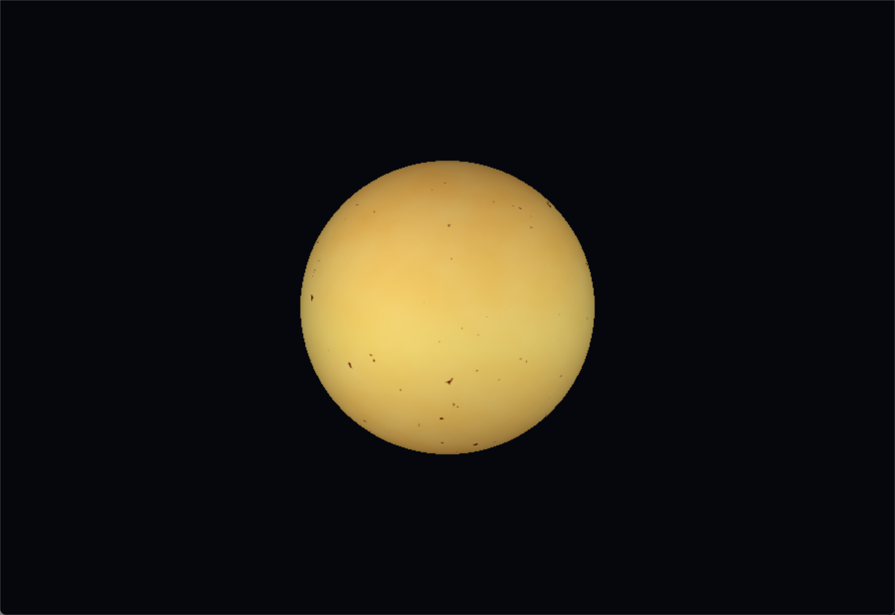
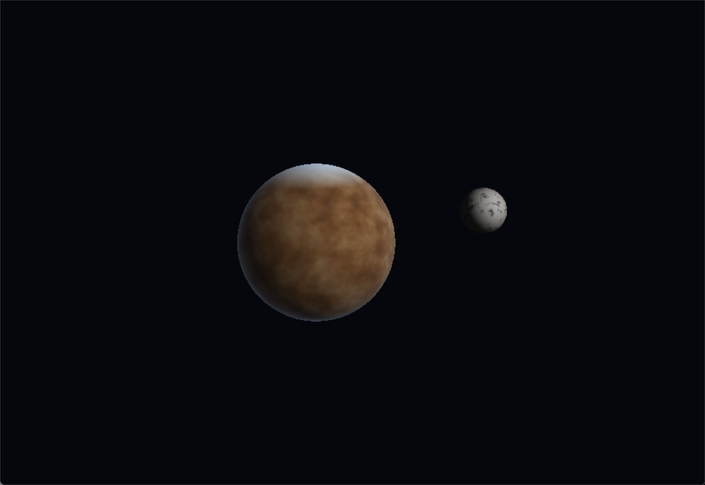
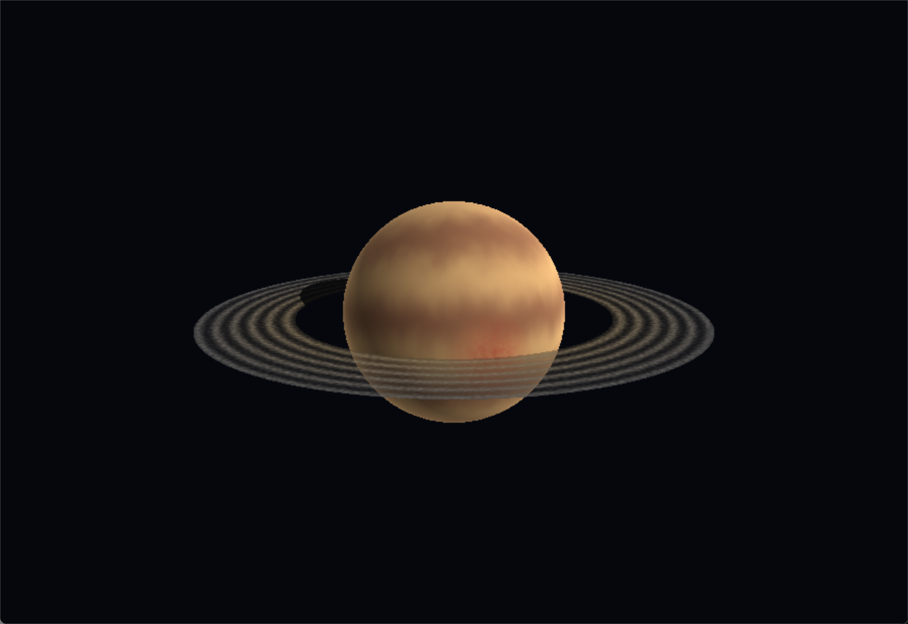

# Cuerpos celestes con shaders (Rust)

Software renderer en Rust: pipeline propio de
transformación de vértices, rasterización con z-buffer y shaders por
fragmento, mostrado en una ventana con [`minifb`](https://crates.io/crates/minifb).
No se usa ninguna textura ni material: todo el color sale de funciones de
shader que combinan ruido procedural, iluminación e interpolación de
atributos.

## Cuerpos

- **Estrella (sol):** 5 capas — gradiente base núcleo/borde, turbulencia de
  plasma animada (ruido fbm), manchas solares (ruido umbralizado), limb
  darkening según el ángulo de vista, y un pulso de brillo en el tiempo.
- **Planeta rocoso:** 5 capas — color por elevación (tierras bajas/medias/
  altas), cráteres (ruido umbralizado), casquetes polares de hielo,
  iluminación Lambertiana + ambiente, y brillo atmosférico delgado (fresnel).
- **Gigante gaseoso:** 4 capas — bandas de latitud deformadas y animadas
  (nubes fluyendo con el tiempo), una tormenta/vórtice localizado, iluminación
  Lambertiana, y una bruma atmosférica gruesa (fresnel).
- **Anillos:** geometría separada (un anillo/disco), 4 capas — gradiente
  radial, bandas de densidad + grano (que también controlan la
  transparencia, simulando huecos), iluminación sobre el plano del anillo, y
  la sombra que el planeta proyecta sobre el anillo (test analítico
  esfera/rayo de luz).
- **Luna:** geometría separada (otra esfera), 4 capas — variación de albedo
  (mares oscuros vs. tierras altas), cráteres densos con reborde, iluminación
  Lambertiana de terminador duro (sin atmósfera), y oscurecimiento sutil del
  borde.

## Controles

- `1` — ver la estrella
- `2` — ver el planeta rocoso con su luna
- `3` — ver el gigante gaseoso con sus anillos
- `Esc` — salir

La cámara es fija en las tres escenas.

## Cómo correr

```
cargo run --release
```

## Capturas

**Estrella**



**Planeta rocoso con su luna**



**Gigante gaseoso con anillos**



## Estructura del código

- `src/framebuffer.rs` — buffer de píxeles + z-buffer, con mezcla alfa para
  los anillos.
- `src/mesh.rs` — generación de la esfera (UV sphere) y del anillo (annulus
  plano); ambas geometrías son independientes y reutilizables.
- `src/shader.rs` — trait `FragmentShader` y los `Uniforms` (tiempo,
  dirección de luz) compartidos por todos los shaders.
- `src/renderer.rs` — pipeline de rasterización: transformación
  objeto→mundo→clip→NDC→pantalla, interpolación con corrección de
  perspectiva, backface culling y prueba de profundidad.
- `src/bodies/*.rs` — un shader por cuerpo celeste (estrella, rocoso,
  gigante gaseoso, anillos, luna).
- `src/main.rs` — ventana, cámara fija, construcción de las 3 escenas y el
  manejo de teclas.
